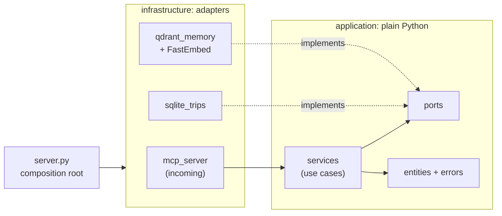

# ✈️ Travel Planner Demo — MCP + RAG over Qdrant

**Give Claude your trips and a searchable travel journal.**

A local [MCP](https://modelcontextprotocol.io) server in Python. Claude can create and read trips, and answer
*"what did I love in Rome?"* from your own notes, citing the exact note it used. Retrieval is RAG over a local
Qdrant vector store with FastEmbed embeddings: no API keys, no cloud, no costs.

## 🧰 What Claude gets

| MCP | Name | What it does |
|---|---|---|
| Tool | `create_trip` · `get_trip` · `list_trips` | Trips in SQLite, with validation and helpful errors |
| Tool | `search_my_travel_memory` | Semantic search over your notes, optional `city` filter, returns sources |
| Resource | `trip://{trip_id}` | One trip as JSON |
| Prompt | `summarize_city` | "What did I love and dislike in X?", grouped and cited |

## 🚀 Quick start

Needs [uv](https://docs.astral.sh/uv/). Runs fully locally.

```
uv sync
cp -r examples/data data                                # PowerShell: Copy-Item -Recurse examples\data data
uv run python -m travel_planner.infrastructure.ingest   # notes -> Qdrant (downloads a ~70 MB model once)
uv run python -m travel_planner.infrastructure.evaluate # retrieval quality: hit rate@5
```

`examples/data` holds 4 fictional trips (Rome, Vienna, Kyoto, Barcelona) and a 100-question eval set.
Replace them with your own notes in `data/notes/` (one `## Place` section per place) and re-run ingest.

Test in the browser with the MCP Inspector:

```
npx @modelcontextprotocol/inspector uv run python -m travel_planner.server
```

## 🔌 Claude Desktop

Add to `claude_desktop_config.json`, then fully quit and reopen Claude:

```json
"travel-planner-demo": {
  "command": "C:\\path\\to\\uv.exe",
  "args": ["--directory", "C:\\path\\to\\travel-planner-demo", "run", "python", "-m", "travel_planner.server"]
}
```

Then ask: *"What did I love in Kyoto?"* or *"Where should I not eat in Barcelona?"*

## 🔎 How the RAG works

1. **Chunk:** each note's `## Place` section becomes one chunk (one place = one meaning = one citable source).
   The place name and country go into the chunk text; front matter becomes metadata.
2. **Stable ids:** `file#section-slug` (e.g. `rome-2025#trattoria-da-lucia`) → a UUID5 point id in Qdrant.
3. **Embed:** FastEmbed `BAAI/bge-small-en-v1.5` (384 dims), locally.
4. **Sync:** re-running ingest overwrites changed chunks and **deletes orphans** (renamed or removed sections),
   so the store always matches the notes.
5. **Search:** cosine similarity in Qdrant, optional payload filter on `city`; results carry `source` + `section`.

## 📊 Results

Retrieval on the sample eval set (`examples/data/eval.yaml`, 100 questions, each with one expected section;
6 per place section, 4 per "Overall" section, a few with a `city` filter):

| Metric | Value |
|---|---|
| hit rate@5 | **94%** (94 / 100) |

The 6 misses are questions worded differently from the note, e.g. *"Which famous cathedral is worth seeing
from the inside?"* (expected Sagrada Família) or *"Where should I bring cash?"* (expected Nishiki Market).

## 🧭 Architecture

Two layers, wired together in one place. Details: [docs/layers.md](docs/layers.md).



- **`application/` never imports MCP, Qdrant or a database**, checked in CI by `import-linter`
- **Ports + adapters:** swap SQLite or Qdrant by writing one new adapter; use cases don't change
- **One use case per class**, each with `invoke()`; tests run them against in-memory fakes
- **Errors written for Claude:** e.g. *"No trip found with id 999. Run list_trips and find the correct trip_id."*

## 🗂️ Code

| Path | Job |
|---|---|
| `server.py` | composition root: adapters → use cases → MCP server |
| `application/entities/` | `Trip` (+ its date rule), `MemoryHit` |
| `application/ports/` | `TripRepository`, `MemorySearch` |
| `application/services/` | `CreateTripService`, `GetTripService`, `ListTripsService`, `SearchMemoryService` |
| `application/helpers/` | `parse_date` |
| `infrastructure/mcp_server.py` | MCP tools, resource, prompt; maps app errors to MCP errors |
| `infrastructure/sqlite_trips.py` | trips in SQLite |
| `infrastructure/qdrant_memory.py` | Qdrant local mode: sync with orphan deletion, filtered search |
| `infrastructure/embeddings.py` | FastEmbed embedder |
| `infrastructure/ingest.py` | Markdown notes → chunks |
| `infrastructure/evaluate.py` | hit rate@k on an eval set |
| `infrastructure/config.py` | all paths (pydantic-settings) |

## ✅ Checks

```
uv run pytest                 # tests (real Qdrant in memory + a fake offline embedder)
uv run ruff check .           # lint
uv run ruff format --check .  # formatting
uv run lint-imports           # architecture: layers stay clean
```

CI (GitHub Actions) runs all four on every push.

## ⚙️ Config

Nothing required. Everything lives in `data/` (git-ignored).
Override with `DATA_DIR`, `DB_PATH`, `QDRANT_PATH`, `NOTES_DIR`, `EVAL_PATH` (see `.env.example`).

## 🛠️ Stack

Python 3.13 · uv · MCP Python SDK · Qdrant (local mode) · FastEmbed · SQLite · pydantic-settings · pytest · Ruff · import-linter · GitHub Actions

## 📄 License

MIT
